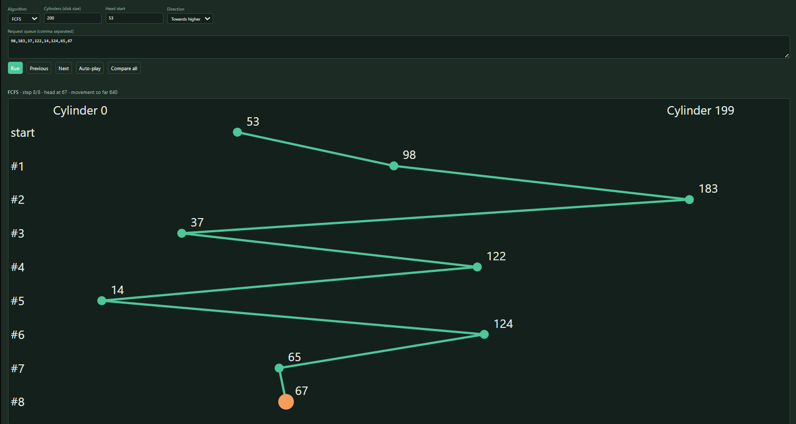
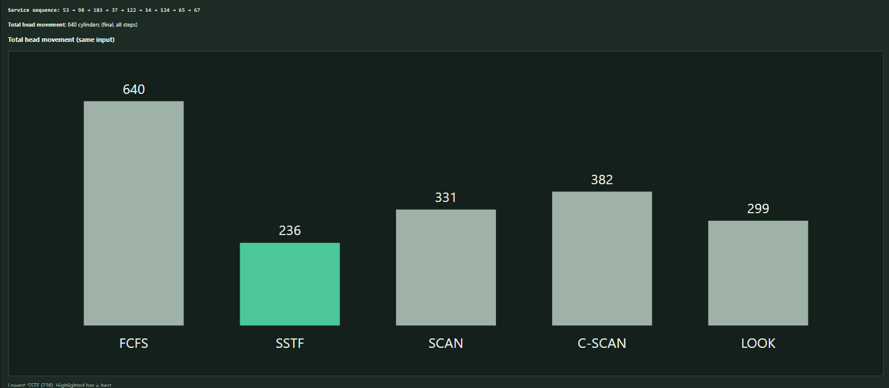
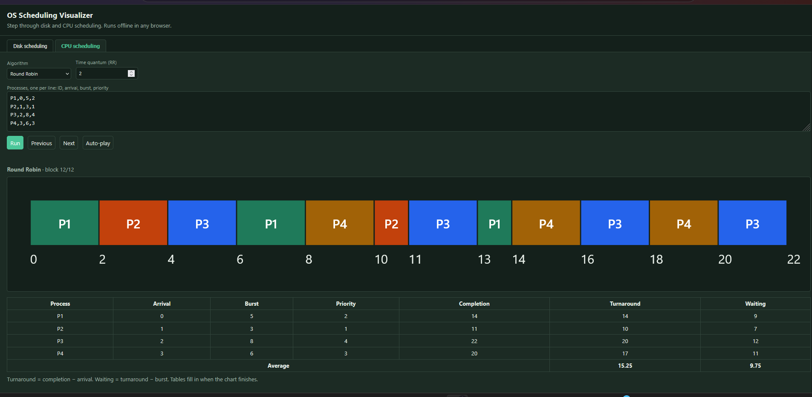

# os-scheduling-visualizerr
Interactive, offline web tool that animates disk scheduling (FCFS, SSTF, SCAN, C-SCAN, LOOK) and CPU scheduling (SJF, RR, SRTF, Priority) with seek graphs, Gantt charts and step-by-step mode. 

## Sample inputs
Disk scheduling 
- Disk size: 200 cylinders (0-199)
- Head start: 50
- Queue: 82,170,43,140,24,16,190
- Expected: FCFS = 642, SSTF = 208

**Starvation case for SSTF**
- Disk size: 200, head start: 50
- Queue: 51,49,52,48,53,47,199

**CPU scheduling**
P1,0,5,2
P2,1,3,1
P3,2,8,4
P4,3,6,3

## Screenshots

### SSTF seek graph

### Comparison of all algorithms

### CPU scheduling: SJF

### CPU scheduling: Round Robin

##Demo Video
https://drive.google.com/file/d/1uTUj1HXZ6_rXlmR0Guuy0VviCgE2zEUN/view?usp=drive_link

**Author:** Amrutha Babu

## Technologies Used
- **HTML5**: page structure, input forms and tabs
- **CSS3**: layout, styling, responsive design and dark mode
- **JavaScript (vanilla)**: all scheduling algorithms, validation and step-by-step animation
- **SVG**: seek graphs, bar charts and Gantt charts drawn in the browser
- **GitHub**: source code hosting and version control
- **GitHub Pages** (optional): free live hosting of the tool

No frameworks, libraries, server or internet connection are needed. The tool runs offline in any modern browser (Chrome, Edge, Firefox, Safari).

## Objectives
- Build an interactive tool that shows how an operating system schedules disk requests and CPU processes.
- Animate FCFS, SSTF, SCAN, C-SCAN and LOOK disk scheduling with a seek graph, service sequence and total head movement.
- Compare all disk algorithms on the same input with a bar chart.
- Animate CPU scheduling (SJF and Round Robin) with a Gantt chart, plus waiting time, turnaround time and their averages.
- Support step-by-step mode (Next/Previous) and auto-play, with input validation.
- Provide a free, offline learning aid for students in rural and resource-limited institutions (SDG 4).
- Study which disk algorithm saves the most energy on low-power servers (SDG 7 and SDG 9).

## Conclusion
This project makes OS scheduling easier to understand by letting students watch each algorithm run step by step instead of reading static diagrams. On the sample input (head 50, queue 82, 170, 43, 140, 24, 16, 190), SSTF moved the head 208 cylinders against 642 for FCFS, but SSTF can starve far requests. LOOK gives the best balance of low head movement, fairness and energy use, which suits low-power and solar-powered servers. For CPU scheduling, SJF gave a lower average waiting time than Round Robin, while Round Robin shared the CPU more fairly. The tool runs in any browser with no install or internet, so it can be used freely in classrooms with limited resources. Future work includes dynamic request arrival, an energy model and more CPU algorithms.

