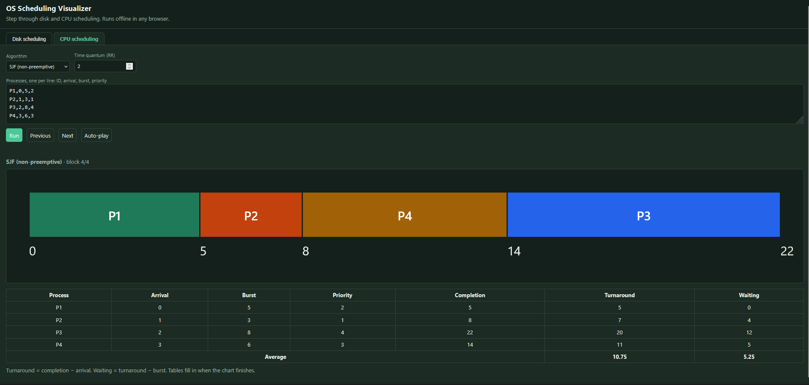

# os-scheduling-visualizerr
Interactive, offline web tool that animates disk scheduling (FCFS, SSTF, SCAN, C-SCAN, LOOK) and CPU scheduling (SJF, RR, SRTF, Priority) with seek graphs, Gantt charts and step-by-step mode. 

## Sample inputs
Disk scheduling 
- Disk size: 200 cylinders (0-199)
- Head start: 50
- Queue: 82,170,43,140,24,16,190
- Expected: FCFS = 642, SSTF = 208

**Starvation case for SSTF**
- Disk size: 200, head start: 50
- Queue: 51,49,52,48,53,47,199

**CPU scheduling**
P1,0,5,2
P2,1,3,1
P3,2,8,4
P4,3,6,3

## Screenshots

### SSTF seek graph

### Comparison of all algorithms

### CPU scheduling: SJF

### CPU scheduling: Round Robin

##Demo Video
https://drive.google.com/file/d/1uTUj1HXZ6_rXlmR0Guuy0VviCgE2zEUN/view?usp=drive_link

Author
Amrutha Babu

